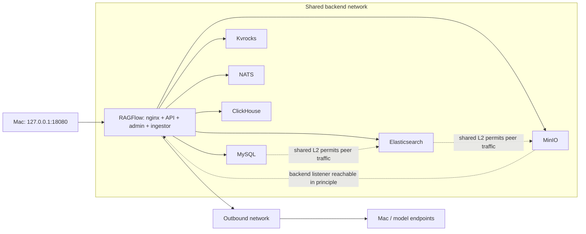
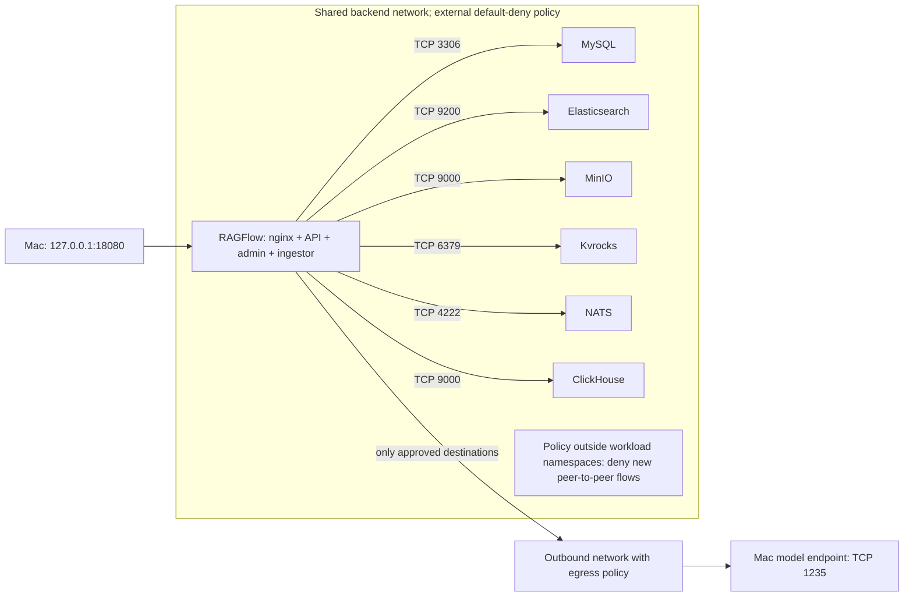
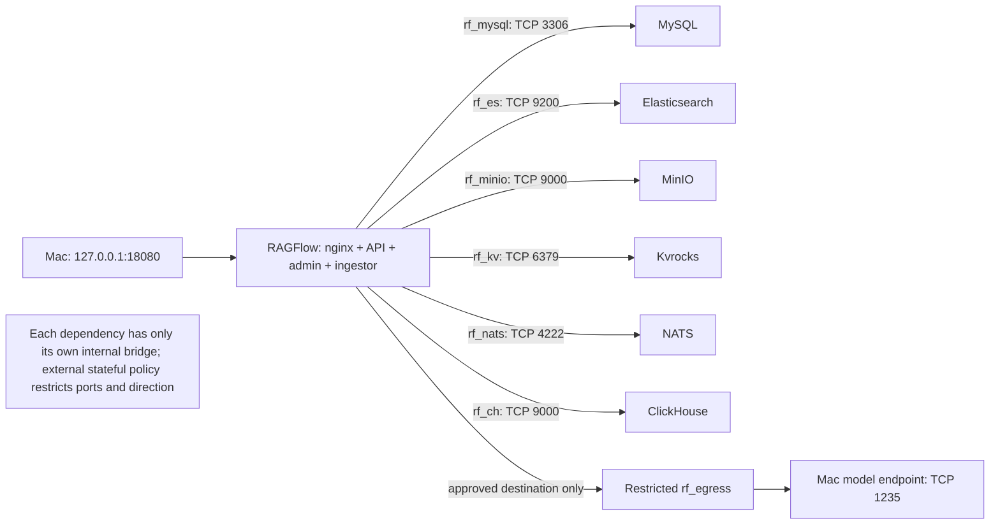
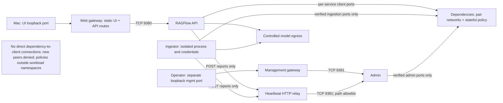

# Security Hardening Proposal: RAGFlow network containment

## Decision

Мы выбираем, насколько далеко разнести сетевые и процессные полномочия существующей локальной лабы. Я рекомендую начать с отдельных сетей для каждой зависимости и stateful default-deny вне контейнеров приложения. Это снижает риск перемещения между сервисами при сохранении их протоколов. Если нам требуется отдельная граница для RCE парсера, придётся также разделить роли RAGFlow.

## Executive Recommendation

Полный набор вариантов: **вариант1 — общая сеть с ACL**, **вариант2 — отдельные сети зависимостей с ACL и ограниченным egress**, **вариант3 — раздельные gateway/API/admin/ingestor с той же сетевой политикой**. Для текущей лабы я выбираю вариант2 по балансу сложности и полезного ограничения путей. Вариант3 даёт более содержательную границу при компрометации RAGFlow, но требует проверки зависимостей каждой роли и heartbeat.

Мы не должны обещать, что запрет лишних портов спасёт базу, к которой приложению разрешены полные права. После RCE приложение сможет использовать свой разрешённый TCP3306/9200/9000 и свои credentials. Сегментация ограничивает соседние поверхности и последующее распространение, а права на данные приходится ограничивать отдельно.

## Evidence

Я открыл текущие файлы конфигурации и исходники вызывающих путей, а также прочитал actual inspect/ss из работающей лабы. Больше всего на рекомендацию повлияли общий backend, wildcard admin-listener и то, что ingestion/API/admin живут в одном контейнере.

| Evidence | Finding or document | What it establishes |
|---|---|---|
| NET | [Runtime: сети контейнеров](../evidence/runtime.json) | Observed: все семь сервисов в backend10.89.0.0/24; только RAGFlow имеет outbound. |
| PORTS | config/service_conf.yaml.template; upstream/docker/kvrocks-entrypoint.sh:33; [ss snapshot](../evidence/runtime.json) | Observed: клиентские 3306/9200/9000/6379/4222; ClickHouse9000 задан конфигом, активный socket в момент снимка не наблюдался. |
| MONOLITH | upstream/docker/entrypoint.sh:164–186; [listeners](../evidence/runtime.json) | Observed: nginx80/API9380/admin9381/ingestor в общем контейнере; admin слушает wildcard. |
| HEARTBEAT | upstream/internal/service/admin_client.go:133; upstream/internal/server/bootstrap/runtime.go:63 | Observed in source: API/ingestor отправляют POST /api/v1/admin/reports. |
| VALIDATED-F01 | Beta expands MCP scope, runtime follow-up13Nov | Observed previously: metadata B раскрывается через API MCP из контейнера; текущий nginx закрывает путь. |
| VALIDATED-F02 | Keys survive deactivation, runtime follow-up13Nov | Observed previously: API-ключ читает исходный документ после деактивации через обычный gateway. |

NET/MONOLITH поддерживают вывод (inferred): один скомпрометированный backend или RAGFlow имеет больше достижимых портов, чем нужно для его штатных клиентских соединений. Новая политика и её свойства ниже — proposed; запрещённые пути в предлагаемой конфигурации ещё не испытывались.

## Current Design And Failure Mode

Сегодня internal:true ограничивает внешнюю маршрутизацию backend, но сохраняет общий L2. Отсутствие ports у MySQL или ES означает отсутствие публикации на Mac, а не отказ соседнему контейнеру. Порт MinIO-console9001 или admin9381 у RAGFlow поэтому нельзя считать защищённым только тем, что он не опубликован.

RAGFlow имеет одновременно backend и outbound. При RCE внутри него атакующий получает штатный маршрут к зависимостям и исходящий путь. Rootless ограничивает воздействие на VM, но не заменяет межсервисную политику. В частности, правило в Mac firewall либо только в default namespace VM не обязано видеть bridged-трафик rootless Netavark до изменения адресов.

Есть ещё граница, которую сеть сейчас вообще не видит: API и ingestor обращаются к admin по localhost9381 внутри общего контейнера. Пока роли остаются вместе, внешняя фильтрация не разрывает этот локальный путь и не разделяет их environment/секреты.

## Desired Invariants

Мы хотим проверяемое поведение: каждая зависимость принимает новые соединения только от RAGFlow на своём клиентском порту; зависимости не инициируют новые соединения к другим зависимостям и к RAGFlow80/9380/9381; ответы на разрешённые соединения проходят по established/related; публичный UI доступен только на Mac-loopback18080. Прямой выход workloads к произвольным внешним адресам, Mac-сервисам и LAN запрещён, за исключением явно разрешённого model endpoint. Рабочий контейнер не может переписать правила: у него нет NET_ADMIN, host network, privileged или управляющего socket.

При пересоздании контейнеров и перезапуске VM политика должна действовать до readiness рабочих сервисов. Мы считаем неисправный или неустановленный фильтр причиной не открывать UI, а не поводом тихо перейти в allow-all.

## Constraints And Non-Goals

Мы не переносим базу, не обновляем RAGFlow, не меняем расположение named volumes и не вводим Kubernetes только ради лабы. Совместимость host/model доступа через Podman Machine надо проверять отдельно; адрес host.containers.internal не является разрешением ко всему Mac. Для существующего LM Studio нужен только TCP1235, когда сервис включён. Новые внешние API разрешаются как конкретные endpoints, а не как весь TCP443.

Эта работа не исправляет F01/F02, prompt injection или ошибки TLS verification. Она также не доказывает безопасность ядра или защиту от container escape. Эти ограничения соответствуют тому, что мы фактически меняем.

## Before Architecture

Диаграмма показывает общую L2-границу. Пунктирные связи обозначают разрешаемую топологией достижимость, а не доказанный exploit каждого сервиса.

Для сравнения дальше мы оставляем те же названия сервисов и меняем только границы доступа. Прямое соединение приложения с зависимостью остаётся в первых двух вариантах.

## Options

### Option 1: Shared backend with external stateful ACL

Мы можем сохранить текущую сеть и ввести политику на уровне Linux networking: разрешить только клиентские пары и ответы established/related, всё остальное между workloads отклонять. Это самый небольшой сетевой diff: DNS и адреса сервисов не меняются, дополнительные процессы не нужны. Вариант привлекателен, если мы готовы надёжно поддерживать один controller правил и хотим быстро убрать обратные подключения к admin.

Его слабое место — зависимость от enforcement на общей L2-сети. Нужно фильтровать именно bridge forwarding, а не предполагать, что inet FORWARD обязательно увидит все пакеты между veth. При потере правил все зависимости снова оказываются соседями. Устойчивость к перезапуску и адресному churn здесь важнее короткого примера iptables.

Производительность меняет обработка правил/conntrack; новое копирование данных не требуется. Мы не измеряли задержку, conntrack memory и CPU. Ошибка в allowlist способна остановить ingestion либо login; staged rollout и наличие rollback обязательны. Откат возвращает текущую топологию и прежний риск, поэтому его выполняют осознанно.

| Change | Before | After | Security consequence | Cost |
|---|---|---|---|---|
| L2 policy | Общая сеть без целевой port policy | Default-deny вне workloads | Запрет лишних peer-портов при работающем фильтре | Controller, conntrack, тесты lifecycle |
| Адреса/приложение | Текущие | Те же | Контроль не отделяет API/admin внутри контейнера | Небольшой миграционный diff |

Мы приобретаем точность без новых сетей, но оставляем последствия ошибки controller максимальными для общего сегмента.

### Option 2: Per-dependency networks plus stateful ACL and constrained egress

Мы создаём шесть внутренних bridge-сетей: **rf_mysql, rf_es, rf_minio, rf_kv, rf_nats, rf_ch**. RAGFlow подключаем к каждой из них, а каждую зависимость — только к своей. Старую общую backend-сеть удаляем из memberships всех сервисов. Сохраняем сервисные aliases mysql/es01/minio/kvrocks/nats/clickhouse. Каждой сети задаём internal:true и явно isolate:strict там, где установленный драйвер это поддерживает.

Такая топология убирает прямое L2-соседство MySQL с ES или MinIO. Мы добавляем внешнюю stateful-политику, чтобы RAGFlow мог обращаться лишь к нужному порту каждой зависимости, а backend не мог инициировать подключение к RAGFlow по общей с ним парной сети. Одни networks, internal или expose эту часть не решают. Сам RAGFlow остаётся многоинтерфейсным доверенным узлом; код при RCE может пересылать данные между своими разрешёнными соединениями, даже если NET_ADMIN отсутствует.

Дополнительных proxy-процессов в этом варианте нет; появляются bridge/veth-интерфейсы, адресные записи и правила. Ожидаемые издержки — kernel bookkeeping/conntrack и операционная сложность; точный RSS/CPU/latency неизвестен. IPAM нужен без пересечения с VPN/LAN. Контроллер может связывать policy с проверенными veth/адресами или применять стабильный IPAM; после recreate он обязан обновить правила атомарно до запуска workload. Мы не должны позволять stale allowlist ссылаться на адрес, который получил другой контейнер.

Отдельный rf_egress оставляем только RAGFlow и ограничиваем его внешними правилами. Для нынешней лабы достаточно исключения к разрешённому model endpoint TCP1235; обычный доступ к интернету/LAN/Mac-сервисам отклоняем. Для будущих облачных моделей можно использовать model gateway с allowlist upstream. Настройка HTTP_PROXY без запрета прямого выхода не создаёт границу: процесс с RCE просто её обойдёт. DNS также должен разрешать необходимые имена, но не давать неограниченный внешний канал.

| Change | Before | After | Security consequence | Cost |
|---|---|---|---|---|
| Соседство зависимостей | Один backend | Своя internal сеть у каждой | Убираем непосредственную peer-достижимость; cross-bridge isolation проверяем | Шесть сетей, IPAM/DNS |
| Порты/направления | Не ограничены точными парами | Client-port only + established/related | Закрываем console/transport/admin и обратные NEW | Внешняя bridge/inet policy |
| Egress | У RAGFlow исходящий путь | Разрешены конкретные назначения | Снижаем SSRF/exfil paths, сохраняя model API | Поддержка endpoint/DNS allowlist |
| Контейнер RAGFlow | API/admin/ingestor вместе | Остаются вместе | RCE приложения сохраняет штатные data permissions | Без process split |

Этот вариант лучше соответствует текущей небольшой лабе. Топология делает намерение читаемым в Compose, а фильтр дополняет её портами. Но мы должны сначала доказать поддержку и persistence политики в rootless namespace, иначе получится только частичная сегментация.

**Стартовая матрица для монолитного RAGFlow:**

| Source | Destination | TCP destination port | Basis |
|---|---|---|---|
| Mac-loopback | RAGFlow nginx | host18080 → container80 | Existing publication |
| RAGFlow | mysql | 3306 | Configuration + established socket |
| RAGFlow | es01 | 9200 | Configuration + established socket |
| RAGFlow | minio | 9000 | Configuration + established socket |
| RAGFlow | kvrocks | **6379** | Actual config/socket, несмотря на EXPOSE6666 |
| RAGFlow | nats | 4222 | Configuration + established sockets |
| RAGFlow | clickhouse | 9000 | Native client configuration; уточнить рабочей нагрузкой |
| RAGFlow egress | approved Mac model endpoint | 1235 | Existing configured model base URL, сейчас сервис может быть выключен |
| Workloads | designated service DNS | UDP/TCP53 | Только необходимый resolver; DNS policy отдельно |
| Reply traffic | Initiator of allowed flow | established/related | Никакого широкого allow на ephemeral ports |

Мы отклоняем все прочие NEW: backend↔backend; backend→RAGFlow80/9380/9381; RAGFlow→MinIO9001, ES9300, MySQL33060, NATS6222/8222, ClickHouse8123/9009 и все неразрешённые destination ports. Это запреты политики, а не утверждение, что каждый из этих портов сейчас слушает. ClickHouse при реальном кодовом пути может потребовать дополнительного обоснованного порта; его не открывают автоматически из списка EXPOSE.

### Option 3: Separate gateway, API, admin and ingestion roles

Если мы хотим сдержать RCE парсера относительно API/admin, нам нужен отдельный workload для ingestion с отдельным namespace, config и набором secrets. Внешний web gateway обслуживает статику и проксирует только API9380. Admin размещаем за отдельным management gateway с отдельным loopback-портом/операторским доступом. Базы остаются в парных сетях и получают только проверенные подключения конкретных ролей.

Я проверил entrypoint: API, admin, ingestor уже запускаются отдельными режимами бинарника, поэтому сама идея не требует нового backend. Однако разделение запуска не означает автоматического разделения полномочий: общий bootstrap и инициализация клиентов могут потребовать больше зависимостей, чем ожидается. Нужны отдельные конфиги, проверка кода каждого режима и один владелец migrations/init. Нельзя просто запустить один и тот же entrypoint четыре раза и считать, что мы получили least privilege.

Особое исключение — heartbeat. API/ingestor сейчас используют localhost9381 и POST /api/v1/admin/reports. После split мы не открываем им весь административный порт: отдельный HTTP relay разрешает только этот метод/path и передаёт в admin. Это сетевой и прикладной boundary; L4 ACL не отличит reports от управления пользователями на том же9381. Relay требует собственной валидации размера/полей и не устраняет возможность подделать разрешённый heartbeat; отключение telemetry вместо relay допустимо только после проверки последствий для конкретной сборки.

Расходы здесь заметнее: дополнительные процессы/контейнеры, повторная загрузка Go/native ресурсов, больше соединений к базам и более сложная готовность сервисов. За это мы получаем независимо ограничиваемые роли и возможность перезапускать ingestor отдельно. Размеры памяти/время старта надо измерить: текущий лимит6GiB у монолита нельзя механически присвоить каждому процессу или считать достаточным для суммы. Откат возвращает общий процессный контейнер без изменения volume-форматов, если мы не совмещаем миграцию ролей с обновлением релиза.

| Change | Before | After | Security consequence | Cost |
|---|---|---|---|---|
| Размещение ролей | Общий контейнер | gateway/API/admin/ingestor отдельно | У RCE каждой роли отдельный набор сети/секретов | Процессы, конфиги, monitoring |
| Admin path | UI и внутренние вызовы в монолите | Management gateway + reports-only relay | Уменьшаем management reachability | L7 policy и тесты heartbeat |
| Data access | Полномочия монолита | Проверенные role credentials/ports | Можно сократить разрешения ingestor/API, если код позволяет | Анализ bootstrap и права БД |

Роли дают самый сильный эффект, когда они действительно получают разные permissions. Если всем скопировать одинаковые root keys и все сети, стоимость вырастет, а основная граница останется прежней.

## Comparison

Мы не измеряли производительность. Таблица показывает ожидаемые механизмы, а не benchmark или интегральный балл. Уверенность относится к описанному направлению, а не к обещанию готового enforcement.

| Dimension | Option1: shared+ACL | Option2: pair networks+ACL | Option3: role split+policy | Basis / validation |
|---|---|---|---|---|
| Security | Меньше портов при исправном фильтре | Дополнительно убирает L2-соседство; монолит остаётся | Добавляет отдельные полномочия ролей | source-derived/high для структуры; динамический deny-тест обязателен |
| Performance | Правила/conntrack | То же + несколько интерфейсов, без application hop | Gateway/relay и role boundaries добавляют hops | hypothetical/medium; p50/p95 retrieval, ingest throughput, CPU |
| Memory | Kernel state | Дополнительные network/policy entries | Дополнительные процессы/пулы/native resources | hypothetical/low; cgroup peak/RSS и conntrack count |
| Reliability | Ошибка ACL влияет на весь сегмент | Ошибка пары локальнее, controller остаётся общим | Раздельные отказы ролей; больше компонентов готовности | source-derived/medium; restart/failed-policy drills |
| Operability | Один controller, сложный L2 enforcement | Читаемая topology + controller/IPAM/DNS | Role configs, credentials, heartbeat relay | source-derived/high; проверка recreate/VM boot |
| Migration | Малый сетевой diff | Смена memberships, сохранение volumes | Новые deployments, единый migration owner | source-derived/medium; сохранность данных и rollback rehearsal |
| Developer ergonomics / drift | Риск забыть новый порт в ACL | Новая зависимость требует явной пары+allow | Новый role path требует identity/secret review | inferred/medium; policy generated from versioned matrix |
| Rollback | Удалить только собственную policy table | Вернуть memberships+собственную policy | Вернуть monolith config при том же образе | source-derived/medium; не трогать data volumes |

Здесь нет варианта, который закрыл бы использование легитимных API/DB-полномочий после RCE. Мы выбираем, насколько эффективно отрежем соседние поверхности и насколько готовы сопровождать enforcement.

## Recommendation

Я рекомендую вариант2, сохранив порт UI18080 и текущий pinned образ. Мы получим проверяемую карту client→service→port и более понятный Compose, не умножая процессы RAGFlow. Вариант1 уместен как краткий промежуточный этап, если сначала нужно освоить и протестировать controller правил. Вариант3 предпочтительнее, если документы поступают от недоверенных сторон и нам нужна отдельная граница между parser RCE и административным контуром.

До внедрения мы должны разрешить вопрос enforcement в нашем rootless namespace. Podman документирует [isolate/internal](https://docs.podman.io/en/latest/markdown/podman-network-create.1.html), но bridge isolation — не port ACL. [podman unshare --rootless-netns](https://docs.podman.io/en/latest/markdown/podman-unshare.1.html) помогает работать с правильным namespace. [nftables](https://netfilter.org/projects/nftables/manpage.html) различает bridge и inet hooks. Мы не будем переносить Docker DOCKER-USER-инструкции на эту установку без проверки.

## Evidence Coverage And Residual Risk

| Evidence | Option1 | Option2 | Option3 | Tactical fix still needed |
|---|---|---|---|---|
| NET — shared backend reachability | mitigates | addresses topology, mitigates port paths | addresses topology, mitigates role paths | Lifecycle tests policy |
| PORTS — excess client-port reachability | mitigates | mitigates | mitigates | Verify actual required ports per role |
| MONOLITH — API/admin/ingestor shared authority | unaffected | unaffected | mitigates, if configs/credentials separated | Listener/config correctness; least privilege |
| HEARTBEAT — reports shares admin port | unaffected | unaffected | mitigates with L7 relay; metadata abuse remains | Validate reports endpoint and relay |
| VALIDATED-F01 — beta MCP scope expansion | unaffected | unaffected | unaffected at authorization layer | Reject/bind beta; retain gateway MCP block |
| VALIDATED-F02 — keys survive deactivation | unaffected | unaffected | unaffected | Active-account check and credential revocation |

Мы оставляем no-new-privileges, отсутствие NET_ADMIN/NET_RAW и Docker socket, выключенные sandbox/MCP/syncer. У RAGFlow сейчас нет NET_ADMIN/NET_RAW в EffectiveCaps; это наблюдение, а не новое изменение. Снижение credentials ES/MinIO от root до прикладных прав полезно отдельно, но оно не достигается только network policy. F01/F02 должны иметь собственные исправления независимо от топологии.

## Migration And Rollout

Мы вводим конфигурацию как отдельный reviewable набор без смены образа и без удаления volumes. Сначала сохраняем конфигурацию и исходную разрешённую матрицу, затем в отдельном окне проверяем новые сети/политику на синтетических данных. Compose override может слить network mappings со старыми: положительный признак миграции — backend отсутствует в actual inspect каждого контейнера, а не наличие новых имён в YAML.

Правила владеют только своей таблицей/цепочками; нельзя делать flush ruleset и уничтожать Netavark или другие политики. Нужны bridge filtering для трафика на одной паре и inet input/forward для gateway/egress по фактическому пути пакета, сохранение reply traffic/DNS/ARP и явная политика IPv6. Мы либо закрываем IPv6 data paths на выбранных workload-сетях, либо покрываем их теми же правилами; IPv4-only allowlist не должен оставлять обход.

После перезапуска policy должна восстанавливаться до readiness. Если совместимость rootless filtering не подтверждается, мы не выдаём топологию за готовую защиту по портам. Можно рассмотреть L4-proxy per dependency: приложение видит только конкретный listener proxy, backend изолирован за ним; это добавляет процессы/hops и требует собственных deny-тестов обхода. Переход к rootful либо другой платформе не делаем молча: это меняет модель привилегий и обращения к volumes.

Rollback возвращает прежние memberships и удаляет только собственную policy; ни down -v, ни переинициализация БД не нужны. На время отката исходный риск общей сети возвращается.

## Validation Plan

Проверяем разрешённые соединения TCP3306/9200/9000/6379/4222/9000 из RAGFlow и отсутствие неожиданных ошибок в login/upload/ingest/retrieval/delete. Синтетический текст должен загрузиться, получить chunks и находиться по маркеру; model endpoint включаем отдельно перед этой проверкой. Снимок ss под нагрузкой уточняет ClickHouse и DNS, но отсутствие одиночного socket не доказывает ненужность сервиса.

Отрицательная матрица включает каждую зависимость как источник к каждой другой, обратные NEW к RAGFlow80/9380/9381, MinIO-console9001, ES9300, MySQL33060, NATS6222/8222, CH8123/9009. Для доказательства port filtering используем контролируемый синтетический listener в disposable workload: connection refused на закрытом порту без listener ещё не доказывает firewall deny. Проверяем counters и источник/назначение в правильном namespace, не оставляя широких разрешений для диагностики.

Отдельно проверяем DNS/rawIP/IPv6, попытки выхода на запрещённый контролируемый LAN/host listener и обход egress по прямому адресу. Не сканируем корпоративную сеть. После container recreate, network recreate и VM restart повторяем негативную матрицу; policy failure должен закрывать readiness. Нужны тесты уже установленных соединений: established-правило может сохранять доступ после ужесточения; свежий rollout/точечная conntrack-cleanup должны учитывать это.

Для performance сравниваем одинаковый корпус и модель на текущей topology и candidate: p50/p95 query latency, upload/ingest throughput, CPU, peak cgroup memory и число соединений. Численного бюджета пользователь не задал; до выбора порога измеряем baseline, согласуем допустимое ухудшение и не выдаём качественный прогноз за измерение.

## Implementation Work Packages

После выбора мы можем оформить отдельный implementation plan: versioned connection matrix/IPAM; конфигурация парных сетей без старого backend; namespace-aware policy controller и startup gate; model/DNS egress; workload positive/negative tests; lifecycle/rollback проверка. Это перечень границ работ, а не применённый Compose или готовый проверенный firewall script. Для варианта3 добавятся ownership migrations, role bootstrap/configs/secrets, отдельный management gateway и reports-only relay.

## Open Questions

Нужно доказать поддержку bridge/inet enforcement и persistence в rootless namespace на этой VM. Требуется уточнить ClickHouse/DNS-пути реальной нагрузкой, разрешённые будущие cloud model endpoints, роль ingestion при отключении внешних загрузок и приоритет разделения admin. Пока эти проверки не сделаны, мы можем выбрать архитектуру, но не считать сетевую защиту внедрённой.
