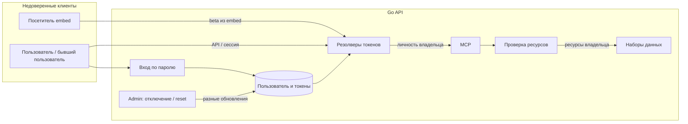
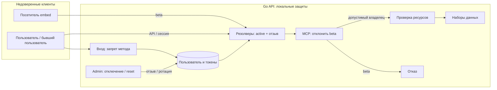
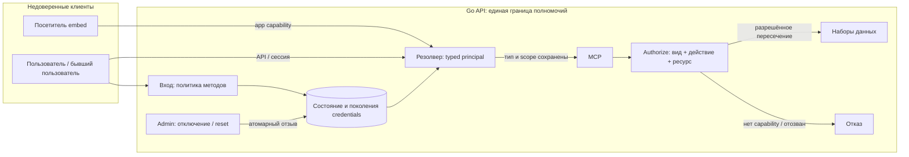

# Security Hardening Proposal: Личность, ограниченные полномочия и отзыв

## Decision

Мы выбираем, где хранить и проверять полномочия credentials между недоверенным клиентом и операцией с данными.

## Executive Recommendation

Доступны **Option 1: Локальные защиты** и **Option 2: Типизированные principal и capabilities**. Я рекомендую второй вариант после немедленных защит первого: общая граница уменьшает вероятность повторения ошибок. При ограниченном сроке мы можем остановиться на первом с обязательной матрицей отрицательных тестов.

## Evidence

Я перечитал перечисленные пути на revision `8cab68a9a3b083da95abb2ea0789b0a5623defaf`. Больше всего на диагноз повлияла потеря типа credentials перед MCP. Наблюдения ниже — **Observed**, вывод об общей причине — **Inferred**; варианты далее — **Proposed**. Проверки runtime не выполнялись.

| Evidence | Finding or document | What it establishes |
|---|---|---|
| e-share | Публичный beta получает область MCP владельца | Embed публикует beta; auth передаёт владельца в MCP. Источники: `web/src/components/embed-dialog/index.tsx:184-187`, `web/src/components/embed-dialog/use-show-embed-dialog.ts:44-52`; `internal/service/api_token.go:96-107`; `internal/handler/auth.go:138-149`; `internal/router/router.go:219-222`; `internal/handler/mcp_server.go:99-106`, `internal/handler/mcp_retrieval.go:62-80`. |
| e-disable | Отключение сохраняет API/beta | `internal/admin/service.go:460-463` пишет непустой INVALID_; `internal/service/user.go:776-795` не проверяет IsActive; OSS `internal/service/stub.go:78-80` не добавляет проверку. |
| e-login | Запрет парольного входа не применяется | Настройка есть в `internal/server/config/api_server_config.go:95-121`; путь `internal/handler/user.go:244` → `internal/service/user.go:308-341` её не применяет. |
| e-reset | Admin reset сохраняет сессии | `internal/admin/service.go:397-429` меняет только пароль; `internal/service/user.go:515-536` принимает прежний AccessToken. Пользовательский reset, напротив, ротирует его: строки 687-689. |

Это source evidence IDs, а не идентификаторы канонических findings. Из них мы выводим, что происхождение полномочий, состояние аккаунта и отзыв принадлежат разным участкам кода.

## Current Design And Failure Mode

Мы видим несколько credential-резолверов, возвращающих общую AuthIdentity. В `internal/handler/auth.go:222-226` контекст ресурсов получает userID; MCP дополнительно сводит авторизацию к владельцу. Проверка ресурсов остаётся, но работает с более широкой личностью, чем ожидает посетитель опубликованного приложения. Отдельные изменения пароля и активности также не образуют единого перехода состояния credentials.

## Desired Invariants

Мы хотим проверяемое поведение: public principal действует только в scope приложения; отключённый владелец не авторизует следующий запрос любого типа; admin reset отзывает сессии; запрещённый метод не создаёт сессию. Каждая операция проверяет вид credentials, действие и конечный ресурс.

## Constraints And Non-Goals

Мы сохраняем Go OSS и вводим проверку внутри процесса. Новый сетевой сервис, переработка retrieval и обещание полной защиты tenant-изоляции вне рассмотренных путей не входят в проект. Бюджеты ресурсов неизвестны. Уже выполняющиеся запросы требуют отдельного решения.

## Before Architecture

Схема показывает границу клиента и API: отдельной процессной изоляции внутри API мы не предполагаем.

Ключевое ребро — передача владельца вместо ограниченного полномочия. Для сравнения доступны [исходная схема](../diagrams/identity-capabilities-before.mmd) и схемы вариантов.

## Options

### Option 1: Локальные защиты

Мы сохраняем существующие контракты и добавляем обязательные guards: отклоняем beta в MCP, проверяем active во всех резолверах, применяем disable-password-login перед выдачей сессии и ротируем сессии при admin reset. Отключение должно отзывать API/beta либо гарантированно блокировать их через состояние владельца. Это сильный выбор для быстрого выпуска: исправления близки к подтверждённым переходам и не требуют новой модели данных.

Цена — мы по-прежнему должны помнить правила в каждом входе. Уже существующее чтение пользователя позволяет проверить active без нового процесса; дополнительные чтения и атомарность отзыва нужно проверить. Мы вводим изменения небольшими пакетами и можем откатывать сопутствующие правки, сохраняя guards и отзыв. Возврат старых полномочий безопасным откатом не считается.

| Change | Before | After | Security consequence | Cost |
|---|---|---|---|---|
| Входы и lifecycle | Разные правила | Guards в каждом пути | Известные обходы закрываются | Повторение проверок |

[Схема варианта 1](../diagrams/identity-capabilities-local-guards-after.mmd) подчёркивает отказ beta-MCP, но общая модель владельца сохраняется.

### Option 2: Типизированные principal и capabilities

Мы сохраняем происхождение credentials в principal: session, API или public-app, идентификатор владельца, разрешённые действия, app/resource scope и поколение отзыва. Сервисная граница принимает principal и вызывает общую Authorize для конечного ресурса; разрешение — пересечение capability и текущих прав владельца. Один userID больше не служит достаточным доказательством полномочий. Публичный токен не получает MCP автоматически.

Общий lifecycle проверяет active и поколения, запрещает метод входа до выдачи credentials и атомарно изменяет состояние при отключении/reset. Для reset мы обязательно отзываем сессии; правила API-ключей фиксируем отдельно. Действующие owner-scoped public beta придётся отозвать и заменить app-scoped ключами: угадывать отсутствующий scope опасно.

Привлекательна единая точка контроля, однако ошибка её реализации затронет все входы. Мы не добавляем сетевой hop; чтение поколения может увеличить нагрузку БД, а кэш способен нарушить немедленный отзыв. Поэтому начальный дизайн обходится без кэша авторизационных решений. Память principal и объём данных поколений необходимо измерить.

Мы переводим вертикальные пути по одному, каждый сразу целиком через новую границу, без разрешающего fallback. Локальные guards остаются до проверки всех callers. При откате возвращаем локальную модель с запретом beta-MCP и сохранённым отзывом: старые опубликованные credentials не восстанавливаем.

| Change | Before | After | Security consequence | Cost |
|---|---|---|---|---|
| Полномочия | userID владельца | Тип, действие, scope | Нет расширения public до owner | Новые контракты |
| Отзыв | Разные обновления | Общий lifecycle | Единое правило следующего запроса | Миграция данных |

[Схема варианта 2](../diagrams/identity-capabilities-typed-principals-after.mmd) сохраняет проверку ресурсов; capability её ограничивает дополнительно.

## Comparison

В таблице указаны ожидаемые направления; измерений нет. **S** означает source-derived, **H** — hypothetical; уверенность и проверки детализированы в [JSON](../hardening.json).

| Dimension | Option 1 | Option 2 | Validation |
|---|---|---|---|
| Security | Улучшение, высокая/S; дрейф guards | Улучшение, средняя/S; общий policy критичен | Матрица токен/действие/ресурс |
| Performance | Неизвестно, низкая/H | Неизвестно, низкая/H; возможны чтения поколения | p95/p99 и запросы БД |
| Memory | Нейтрально, средняя/H | Неизвестно, низкая/H; principal/данные | heap, RSS, индексы |
| Reliability | Улучшение, средняя/S | Неизвестно, средняя/H; общая точка отказа | Сбой БД, гонки отзыва |
| Operability | Усложнение, средняя/H | Усложнение, средняя/H | Причины отказов, учения |
| Migration | Нейтрально, средняя/S | Усложнение, высокая/S | Клиенты, embed, переиздание |
| Developer ergonomics | Неизвестно, средняя/S | Улучшение, средняя/H | Review нового endpoint |
| Rollback | Нейтрально, средняя/H | Усложнение, средняя/H | Откат без отмены отзыва |

Решающая цена второго варианта — переход контрактов и credentials, а не дополнительный сервис. При недостатке ресурсов мы можем получить полезное снижение риска первым вариантом.

## Recommendation

Я рекомендую Option 2 поэтапно, если проект готов поддерживать единый контракт авторизации. Если важнее ближайший выпуск, выбираем Option 1 и отдельного владельца матрицы проверок. Измеренная неприемлемая задержка или отсутствие достоверного app scope потребуют пересмотра второго варианта.

## Evidence Coverage And Residual Risk

Эффект обозначает ожидаемый результат реализации, а не закрытие находок.

| Evidence | Option 1 | Option 2 | Tactical patch |
|---|---|---|---|
| e-share — Публичный beta/MCP | addresses | addresses | Нужен до повторной проверки |
| e-disable — Отключённые API/beta | addresses | addresses | Нужен до повторной проверки |
| e-login — Запрет парольного входа | addresses | addresses | Нужен до повторной проверки |
| e-reset — Admin reset и сессии | addresses | addresses | Нужен до повторной проверки |

Мы всё ещё зависим от корректности ресурсных прав и полноты списка callers. In-flight запросы, enterprise-реализация и deployed image остаются отдельными вопросами.

## Migration And Rollout

Сначала выпускаем guards и отзываем раскрытые широкие beta. Затем вводим principal/lifecycle, переводим MCP и остальные входы, переиздаём public ключи и удаляем старый путь. На каждом этапе проверяем разрешённый embed и обычный MCP. Откат сохраняет отзыв и ограничения.

## Validation Plan

Проверяем прямой API без proxy: четыре исходных сценария должны отклоняться; разрешённые запросы сохраняются. Для одинакового workload сравниваем baseline и оба варианта по p95/p99, DB QPS, heap/RSS; пороги согласуем до rollout. Проверяем конкуренцию disable/request и отказ БД. Запускаем профильные Go-тесты через `bash build.sh --test`; здесь они не выполнялись.

## Implementation Work Packages

После выбора нужны контракты и матрица запретов, lifecycle/schema, перевод callers, переиздание credentials, затем проверка нагрузки и rollback. Приёмка требует отсутствия привилегированного пути только с ambient userID и отзыва на следующем запросе. Отдельный implementation plan пока не создан.

## Open Questions

Каков app-to-dataset scope? Какие API-ключи отзывать при reset? Допустима ли задержка дополнительных чтений? Что делать с уже выполняющимися запросами?
